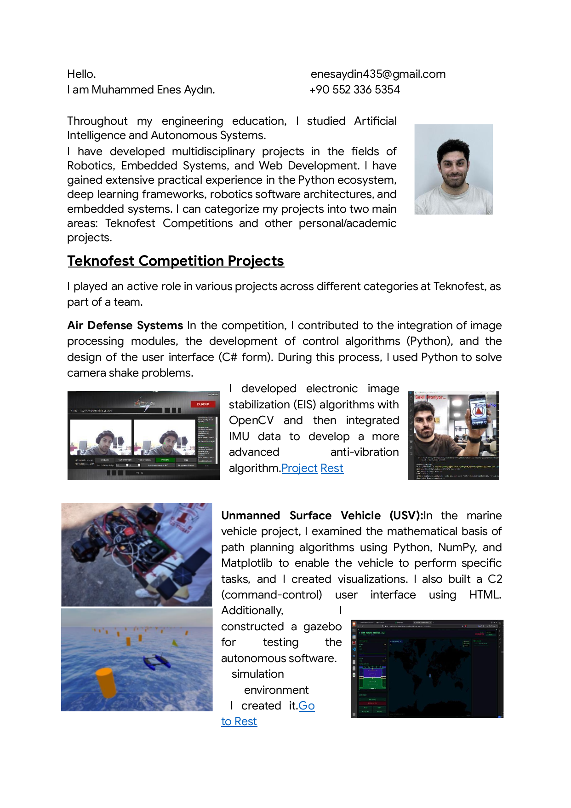

<h1 align="center">Hi, I'm Muhammet Enes Aydın 👋</h1>

  

  
  
  
  
  
  

---

## 🚀 About Me

- 🎓 Engineering student and developer specializing in **Artificial Intelligence & Autonomous Systems**, building multidisciplinary projects across **Robotics**, **Computer Vision**, **Embedded Systems & PCB Design**, **Protocol Security**, and **Web Development**.
- 🤖 Hands-on experience with **ROS / ROS 2 (Humble)**, **Gazebo**, **ArduPilot**, **MoveIt 2**, **PyTorch**, **OpenCV**, **NVIDIA TensorRT**, **ESP32 / LoRa**, and **FastAPI / React**.
- 🏆 Active **Teknofest** competitor across **Air Defense Systems**, **Combat UAV**, **Unmanned Surface Vehicle (USV)**, and **NLP** categories.
- 🤝 Open to collaborations in autonomous systems, robotics, real-time computer vision, embedded engineering, and security.

---

## 💼 Experience

### 🔹 Degz Robotics — *Engineering Intern*
- **Autonomous ROV Simulation:** Conducted autonomous driving tests for the **BlueROV2** platform in **Gazebo** & **ArduPilot**; established bidirectional **ROS 2 Humble ↔ Gazebo** communication (`ros_gz_bridge`); implemented autonomous arming, steering, and thrust control via **Pymavlink**; analyzed real-time telemetry with **PlotJuggler**.
- **3D Path Planning & Control:** Developed a **3D RRT** obstacle-avoidance path planner in Python paired with **Model Predictive Control (MPC)** to track 3D trajectories under speed and orientation constraints.
- **Robotic Arm Motion Planning:** Imported manipulator kinematic models into **ROS 2 Humble** & **MoveIt 2**, executing inverse kinematics, trajectory generation, and collision checking with simultaneous **RViz2** and **Gazebo** integration.
- **Embedded Hardware & PCB Design:** Designed production-ready schematics and PCBs for the **`ESP32_USB V1`** development module (LDO voltage regulator + USB interface) and a **Stepper Motor Driver** board featuring current sensing, reference voltage adjustment, and thermal cooling pads.

### 🔹 Bluesense — *Volunteer Intern*
- Built a lightweight deep learning model (**MobileNetV3**) to predict hydration levels from facial images.

---

## 🛠️ Tech Stack & Tools

  <strong>Languages:</strong> 
  
  
  
  
  
  
  

  <strong>Robotics & Autonomy:</strong> 
  
  
  
  
  
  
  

  <strong>AI & Computer Vision:</strong> 
  
  
  
  
  
  
  
  

  <strong>Embedded & DevOps:</strong> 
  
  
  
  
  
  
  
  

  <strong>Security & Protocols:</strong> 
  
  
  

  <strong>Web & Backend:</strong> 
  
  
  
  

---

## 🏆 Teknofest & Robotics Highlights

| Project | Overview | Link |
| :--- | :--- | :---: |
| **Air Defense Systems** | OpenCV Electronic Image Stabilization (EIS) + IMU anti-vibration pipeline, Python control algorithms, and C# UI | [Repo](https://github.com/STNM2025/2025-Hava-Savunma-Sistemi) |
| **Combat UAV** | PyQt5 GCS (900 MHz RF), YOLOv7 (98% accuracy on ~100k dataset + semi-auto labeling bot), DeepSORT/ByteTrack, and ROS & Gazebo target-locking/kamikaze | [Repo](https://github.com/muhammetenesaydin/UAV) |
| **Unmanned Surface Vehicle (USV)** | Python/NumPy/Matplotlib path planning, HTML C2 UI, and Gazebo & ArduPilot SITL simulation | [Repo](https://github.com/muhammetenesaydin/gazebosim_blueboat_ardupilot_sitl) |
| **Unmanned Underwater Vehicle (ROV / UUV)** | Comparative A\*, D\*, RRT, and RRT\* path planning benchmarks for underwater navigation | [Repo](https://github.com/muhammetenesaydin/ROV) |
| **LLMbot** | Real-time LLM perception-decision-action vehicle control loop driven by live sensor inputs in simulation | [Repo](https://github.com/muhammetenesaydin/RAP-2025-Project-Group-2) |
| **Autonomous Lawn Mower & Gesture Control** | ESP32 Python autonomous control with Bluetooth mobile UI; MediaPipe + OpenCV hand-gesture vehicle control | [Portfolio](./portfoy_Eng.pdf) |

---

## 🔬 AI, Security & Software Projects

| Project | Overview | Link |
| :--- | :--- | :---: |
| **YOLOv8 TensorRT Optimization** | FP16/INT8 quantization & layer fusion boosting inference speed from 30–40 FPS to **120–150 FPS** | [Repo](https://github.com/muhammetenesaydin/YOLOv8-TensorRT) |
| **EV Charging Station Security** | Random Forest multi-factor anomaly detection across **CAN** and **OCPP** protocols | [Repo](https://github.com/muhammetenesaydin/EV-Charging_Station_Secure) |
| **Multi-Source Search API** | AI project planner using **FastAPI**, **React**, and **Gemini API** scanning GitHub & arXiv | [Repo](https://github.com/muhammetenesaydin/Multi-Source-Search-API) |
| **RL Sandbox** | 2D autonomous vehicle control with NEAT & CartPole stabilization with DQN | [Repo](https://github.com/muhammetenesaydin/RL-Sandbox) |
| **TabPFN Benchmarks** | Accuracy, generalization & latency comparison of TabPFN vs XGBoost & LightGBM | [Repo](https://github.com/muhammetenesaydin/TabPFN) |
| **NLP Sentiment Analysis** | Teknofest text sentiment classification (~95% accuracy) | [Repo](https://github.com/muhammetenesaydin/Natural-Language-processing) |
| **Task Manager Platform** | Internal Trello + Udemy hybrid task & learning management prototype | [Repo](https://github.com/muhammetenesaydin/task_manager2) |
| **GANs & LeetCode 75** | Vanilla GAN image generation & structured Python algorithm solutions | [GANs](https://github.com/muhammetenesaydin/GANs) · [LeetCode 75](https://github.com/muhammetenesaydin/LeetCode-75-solutions) |

---

## 📄 Portfolio

  

  

<b>📖 View Remaining Portfolio Pages (Pages 2–5)</b>

 

    
    
    
  

---

## 📊 GitHub Stats

  
  

  

---

  Feel free to reach out for collaborations or opportunities — <a href="mailto:enesaydin435@gmail.com">enesaydin435@gmail.com</a> · <a href="https://www.linkedin.com/in/enesaydin0000">LinkedIn</a>

  <a href="#top">⬆️ Back to Top</a>

