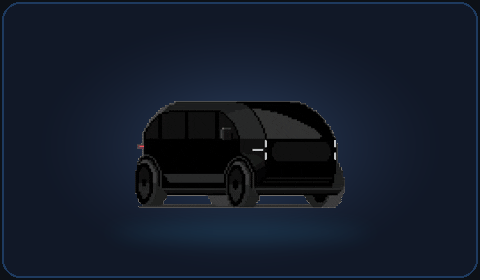
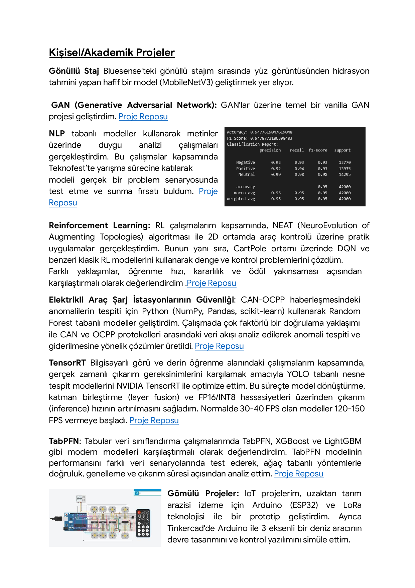
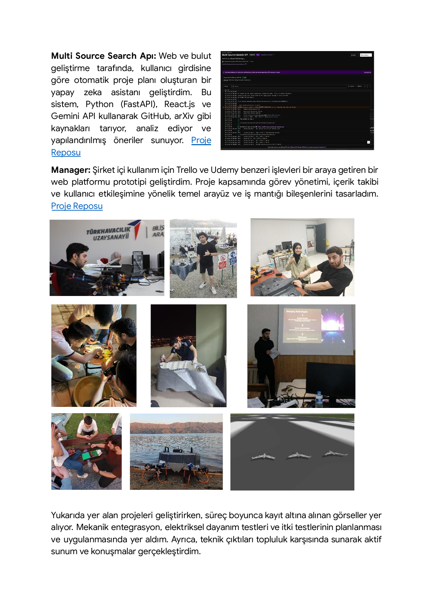

<a id="top"></a>

<p align="center">
  
</p>

<p align="center">
  <a href="https://www.linkedin.com/in/enesaydin0000">
    
  </a>
  <a href="mailto:enesaydin435@gmail.com">
    
  </a>
  <a href="https://leetcode.com/u/Enes_435/">
    
  </a>
  <a href="https://www.codewars.com/users/Enes_435">
    
  </a>
  <a href="./portfoy_Eng.pdf">
    
  </a>
  
</p>

---

## 🚀 About Me



- 🎓 Engineering student and developer specializing in **Artificial Intelligence & Autonomous Systems**, building multidisciplinary systems across **Robotics**, **Computer Vision**, **Embedded Systems & PCB Design**, **Protocol Security**, and **Full-Stack Web**.
- 🤖 Practical experience bridging simulation and hardware with **ROS 2 (Humble)**, **Gazebo**, **ArduPilot**, **MoveIt 2**, **PyTorch**, **OpenCV**, **NVIDIA TensorRT**, **ESP32 / LoRa**, and **FastAPI / React**.
- 🏆 Active **Teknofest** competitor across **Air Defense Systems**, **Combat UAV**, **Unmanned Surface Vehicle (USV)**, and **NLP** categories.
- 🤝 Open to collaborations in autonomous vehicles, robotics, real-time vision, embedded engineering, and cybersecurity.

```python
# engineer_profile.py
class MuhammetEnesAydin:
    focus      = ["Robotics & Autonomous Vehicles", "Computer Vision", "Embedded & Security"]
    autonomy   = ["ROS 2 Humble", "Gazebo", "ArduPilot", "MoveIt 2", "3D RRT & MPC"]
    ai_vision  = ["PyTorch", "YOLOv7/v8", "TensorRT (120-150 FPS)", "OpenCV"]
    hardware   = ["ESP32", "LoRa", "PCB Design", "CAN / OCPP Protocols"]
    web_stack  = ["FastAPI", "React.js", "PostgreSQL", "Gemini API"]
    mindset    = "Simulation -> Real-Time Optimization -> Field Deployment"
```

<br clear="right"/>

<div align="center">

| ⚡ Real-Time AI | 🎯 Combat UAV Vision | 🤖 Multi-Domain Robotics | 🏆 Competitions |
| :---: | :---: | :---: | :---: |
| **120–150 FPS** | **98% Accuracy** | **UAV · USV · ROV** | **Teknofest** |
| YOLO + TensorRT FP16/INT8 | YOLOv7 on 100k+ dataset | ROS 2 · Gazebo · ArduPilot | Air Defense · UAV · USV · NLP |

</div>

---

## 💼 Experience


### 🔹 Degz Robotics — *Engineering Intern*
- **Autonomous ROV Simulation:** Conducted autonomous driving tests for the **BlueROV2** platform in **Gazebo** & **ArduPilot**; established bidirectional **ROS 2 Humble ↔ Gazebo** communication (`ros_gz_bridge`); implemented autonomous arming, steering, and thrust control via **Pymavlink**; analyzed real-time telemetry with **PlotJuggler**.
- **3D Path Planning & Control:** Developed a **3D RRT** obstacle-avoidance path planner in Python paired with **Model Predictive Control (MPC)** to track 3D trajectories under speed and orientation constraints.
- **Robotic Arm Motion Planning:** Imported manipulator kinematic models into **ROS 2 Humble** & **MoveIt 2**, executing inverse kinematics, trajectory generation, and collision checking with simultaneous **RViz2** and **Gazebo** integration.
- **Embedded Hardware & PCB Design:** Designed production-ready schematics and PCBs for the **`ESP32_USB V1`** development module (LDO voltage regulator + USB interface) and a **Stepper Motor Driver** board featuring current sensing, reference voltage adjustment, and thermal cooling pads.

### 🔹 Bluesense — *Volunteer Intern*
- Built a lightweight deep learning model (**MobileNetV3**) to predict hydration levels from facial images.

<br clear="right"/>

---

## 🛠️ Tech Stack & Core Domains

<p align="center">
  
</p>

<div align="center">

| 🤖 Robotics & Autonomy | 🧠 AI & Computer Vision |
| :--- | :--- |
| ROS 2 (Humble), Gazebo, ArduPilot, PX4, MAVLink / Pymavlink, MoveIt 2, RViz2, PlotJuggler, 3D RRT / RRT\* / MPC | PyTorch, OpenCV, NVIDIA TensorRT (FP16/INT8), YOLOv7/v8, DeepSORT / ByteTrack, MediaPipe, TabPFN, Scikit-learn, Jupyter |

| 🔌 Embedded & Hardware | 🛡️ Security & Full-Stack Web |
| :--- | :--- |
| ESP32, Arduino, LoRa, Schematic & PCB Design, CAN Bus, Stepper Drivers, Linux / Ubuntu, Docker, Make | CAN–OCPP Anomaly Detection, FastAPI, Flask, React.js, Gemini API, PostgreSQL, C2 Interfaces |

</div>

---

## 🚀 Featured Projects

<p align="center">
  <a href="https://github.com/muhammetenesaydin/YOLOv8-TensorRT">
    
  </a>
  <a href="https://github.com/muhammetenesaydin/EV-Charging_Station_Secure">
    
  </a>
</p>
<p align="center">
  <a href="https://github.com/muhammetenesaydin/UAV">
    
  </a>
  <a href="https://github.com/muhammetenesaydin/Multi-Source-Search-API">
    
  </a>
</p>

### 🏆 Teknofest & Autonomous Systems

| Project | Overview | Link |
| :--- | :--- | :---: |
| **Air Defense Systems** | OpenCV Electronic Image Stabilization (EIS) + IMU anti-vibration pipeline, Python control algorithms, and C# UI | [Repo](https://github.com/STNM2025/2025-Hava-Savunma-Sistemi) |
| **Combat UAV** | PyQt5 GCS (900 MHz RF), YOLOv7 (98% accuracy on ~100k dataset + semi-auto labeling bot), DeepSORT/ByteTrack, and ROS & Gazebo target-locking/kamikaze | [Repo](https://github.com/muhammetenesaydin/UAV) |
| **Unmanned Surface Vehicle (USV)** | Python/NumPy/Matplotlib path planning, HTML C2 UI, and Gazebo & ArduPilot SITL simulation | [Repo](https://github.com/muhammetenesaydin/gazebosim_blueboat_ardupilot_sitl) |
| **Unmanned Underwater Vehicle (ROV / UUV)** | Comparative A\*, D\*, RRT, and RRT\* path planning benchmarks for underwater navigation | [Repo](https://github.com/muhammetenesaydin/ROV) |
| **LLMbot** | Real-time LLM perception-decision-action vehicle control loop driven by live sensor inputs in simulation | [Repo](https://github.com/muhammetenesaydin/RAP-2025-Project-Group-2) |
| **Autonomous Lawn Mower & Gesture Control** | ESP32 Python autonomous control with Bluetooth mobile UI; MediaPipe + OpenCV hand-gesture vehicle control | [Portfolio](./portfoy_Eng.pdf) |

### 🔬 AI, Security & Software Engineering

| Project | Overview | Link |
| :--- | :--- | :---: |
| **YOLOv8 TensorRT Optimization** | FP16/INT8 quantization & layer fusion boosting inference speed from 30–40 FPS to **120–150 FPS** | [Repo](https://github.com/muhammetenesaydin/YOLOv8-TensorRT) |
| **EV Charging Station Security** | Random Forest multi-factor anomaly detection across **CAN** and **OCPP** protocols | [Repo](https://github.com/muhammetenesaydin/EV-Charging_Station_Secure) |
| **Multi-Source Search API** | AI project planner using **FastAPI**, **React**, and **Gemini API** scanning GitHub & arXiv | [Repo](https://github.com/muhammetenesaydin/Multi-Source-Search-API) |
| **RL Sandbox** | 2D autonomous vehicle control with NEAT & CartPole stabilization with DQN | [Repo](https://github.com/muhammetenesaydin/RL-Sandbox) |
| **TabPFN Benchmarks** | Accuracy, generalization & latency comparison of TabPFN vs XGBoost & LightGBM | [Repo](https://github.com/muhammetenesaydin/TabPFN) |
| **NLP Sentiment Analysis** | Teknofest text sentiment classification (~95% accuracy) | [Repo](https://github.com/muhammetenesaydin/Natural-Language-processing) |
| **Task Manager Platform** | Internal Trello + Udemy hybrid task & learning management prototype | [Repo](https://github.com/muhammetenesaydin/task_manager2) |
| **GANs & LeetCode 75** | Vanilla GAN image generation & structured Python algorithm solutions | [GANs](https://github.com/muhammetenesaydin/GANs) · [LeetCode 75](https://github.com/muhammetenesaydin/LeetCode-75-solutions) |

---

## 📄 Portfolio

<p align="center">
  <a href="./portfoy_Eng.pdf">
    
  </a>
</p>

<p align="center">
  <a href="./portfoy_Eng.pdf">
    
  </a>
</p>

<details>
<summary><b>📖 View Remaining Portfolio Pages (Pages 2–5)</b></summary>
<br/>
<p align="center">
  <a href="./portfoy_Eng.pdf"></a><br/><br/>
  <a href="./portfoy_Eng.pdf"></a><br/><br/>
  <a href="./portfoy_Eng.pdf"></a><br/><br/>
  <a href="./portfoy_Eng.pdf"></a>
</p>
</details>

---

## 📊 GitHub & Coding Analytics

<p align="center">
  
  
</p>

<p align="center">
  
  
</p>

<p align="center">
  
</p>

---

<p align="center">
  Feel free to reach out for collaborations or opportunities — <a href="mailto:enesaydin435@gmail.com">enesaydin435@gmail.com</a> · <a href="https://www.linkedin.com/in/enesaydin0000">LinkedIn</a>
</p>

<p align="center">
  <a href="#top">⬆️ Back to Top</a>
</p>

<p align="center">
  
</p>
