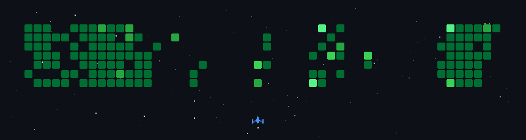
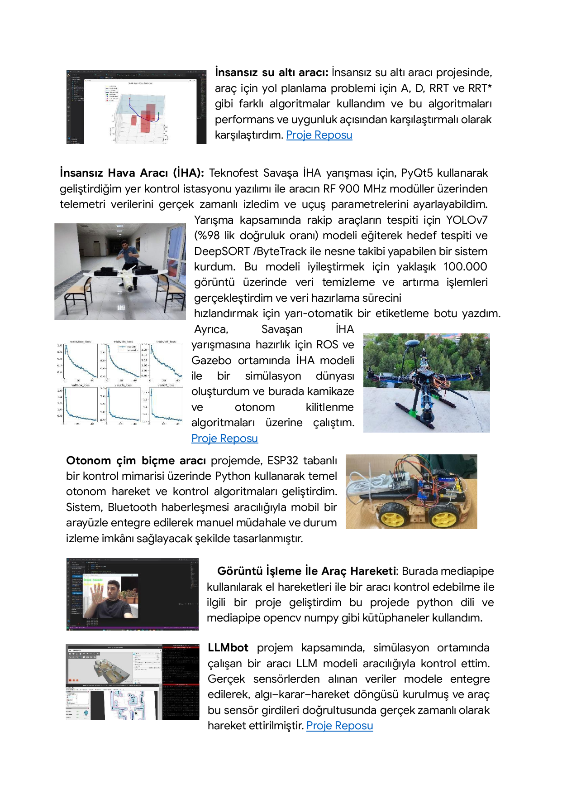

# 👋 Merhaba, Ben Muhammet Enes Aydın

  

  
  
  
  
  

---

## 📌 Hakkımda

Mühendislik eğitimim boyunca **Yapay Zeka**, **Otonom Sistemler**, **Robotik**, **Gömülü Sistemler** ve **Web Geliştirme** alanlarında çok disiplinli projeler geliştirdim. 

Python ekosistemi, derin öğrenme çatıları (PyTorch, TensorFlow), robotik yazılım mimarileri (ROS / ROS 2, Gazebo), model optimizasyonları (TensorRT) ve gömülü sistemler (ESP32, STM32, LoRa, PCB tasarımı) üzerinde yoğun pratik deneyime sahibim.

---

## 🛠️ Yetenekler & Teknolojiler

- **Diller:** Python, C++, C#, HTML5, CSS3, JavaScript
- **Yapay Zeka & Görüntü İşleme:** PyTorch, OpenCV, NVIDIA TensorRT, MediaPipe, YOLO (v7/v8), DeepSORT, ByteTrack, scikit-learn, TabPFN
- **Robotik & Simülasyon:** ROS, ROS 2 (Humble), Gazebo, ArduPilot (SITL), MoveIt 2, RViz2, PlotJuggler, Pymavlink
- **Otonom Kontrol & Algoritmalar:** Path Planning (A\*, D\*, RRT, 3D RRT, RRT\*), Model Predictive Control (MPC), Kalman / EIS
- **Gömülü Sistemler & Donanım:** ESP32, Arduino, LoRa, Schematics & PCB Tasarımı, CAN-Bus, Step Motor Sürücüleri
- **Web & Araçlar:** FastAPI, React.js, Git, GitHub Actions, Linux / Ubuntu, C2 Arayüzleri

---

## 🏆 Teknofest Yarışma Projeleri

- **🎯 Hava Savunma Sistemleri**
  - Görüntü işleme modülleri entegrasyonu, kontrol algoritmaları ve C# Form arayüzü.
  - Kamera titreşimleri için OpenCV ile Elektronik Görüntü Sabitleme (EIS) ve IMU verisiyle hibrit anti-titreşim algoritması.
  - 🔗 [Proje Reposu](https://github.com/STNM2025/2025-Hava-Savunma-Sistemi)

- **🚤 İnsansız Deniz Aracı (İDA)**
  - Gazebo & ArduPilot ortamında simülasyon dünyası.
  - Python, NumPy ve Matplotlib ile yol planlama altyapısı ve görselleştirmesi; HTML tabanlı C2 komuta kontrol arayüzü.
  - 🔗 [Proje Reposu](https://github.com/muhammetenesaydin/gazebosim_blueboat_ardupilot_sitl)

- **🌊 İnsansız Su Altı Aracı (İSA)**
  - Yol planlama problemi için A\*, D\*, RRT ve RRT\* algoritmalarının karşılaştırmalı analizi ve simülasyonu.
  - 🔗 [Proje Reposu](https://github.com/muhammetenesaydin/ROV)

- **✈️ Savaşan İHA (Teknofest Savaşan İHA Yarışması)**
  - RF 900 MHz telemetri izleme ve kontrol için PyQt5 tabanlı Yer Kontrol İstasyonu (GCS).
  - %98 doğruluk oranına sahip özel YOLOv7 hedef tespit modeli, 100.000+ görüntü ön işleme & yarı-otomatik etiketleme botu.
  - DeepSORT / ByteTrack ile nesne takibi; ROS & Gazebo ortamında kamikaze ve otonom kilitlenme algoritmaları.
  - 🔗 [Proje Reposu](https://github.com/muhammetenesaydin/UAV)

- **🤖 LLMbot (Dil Modeli Destekli Robot Kontrolü)**
  - Simülasyon ortamındaki bir aracın LLM modeline bağlanan sensör girdileriyle kontrolü (Algı - Karar - Hareket döngüsü).
  - 🔗 [Proje Reposu](https://github.com/muhammetenesaydin/RAP-2025-Project-Group-2)

- **🌱 Otonom Çim Biçme Aracı**
  - ESP32 tabanlı otonom kontrol ve Bluetooth ile mobil arayüz entegrasyonu.

- **✋ Görüntü İşleme ile Araç Kontrolü**
  - MediaPipe, OpenCV ve NumPy kullanılarak el hareketleri ile gerçek zamanlı araç kontrolü.

---

## 💼 Staj & Sektör Deneyimi

### 🔹 Degz Robotik – Stajyer Mühendis
- **Otonom ROV Simülasyonu:** Gazebo ve ArduPilot ile BlueROV2 otonom sürüş testleri; ROS 2 Humble ile `ros_gz_bridge` çift yönlü haberleşme; Pymavlink ile otonom arming/itki kontrolü; PlotJuggler analizi.
- **3B Rota Planlama & Kontrol:** Su altı aracı için 3D RRT algoritması ve rotaların takibi için Model Predictive Control (MPC) mimarisi.
- **Robotik Kol Hareket Planlama:** Manipülatör kinematik modellerinin ROS 2 Humble ve MoveIt 2 ortamına aktarılması (ters kinematik, yörünge üretimi, çarpışma kontrolü, RViz2).
- **Gömülü Donanım & PCB Tasarımı:** LDO regülatörlü ESP32_USB V1 geliştirme modülü ve akım algılamalı Step Motor Sürücü kartı şematik ve PCB tasarımı.

### 🔹 Bluesense – Gönüllü Staj
- Yüz görüntülerinden hidrasyon tahmini yapan hafif derin öğrenme modeli (MobileNetV3) geliştirilmesi.

---

## 🔬 Kişisel & Akademik Projeler

| Proje | Açıklama | Bağlantı |
| :--- | :--- | :---: |
| **🚀 YOLOv8 TensorRT Optimizasyonu** | YOLO modellerinin FP16/INT8 ve layer fusion ile optimize edilerek 30-40 FPS'ten **120-150 FPS** çıkarım hızına ulaştırılması. | [Repo](https://github.com/muhammetenesaydin/YOLOv8-TensorRT) |
| **⚡ Elektrikli Araç Şarj Güvenliği** | CAN-OCPP protokol haberleşmesinde anomali tespiti için Random Forest tabanlı çok faktörlü doğrulama modeli. | [Repo](https://github.com/muhammetenesaydin/EV-Charging_Station_Secure) |
| **🎮 RL Sandbox & Kontrol** | NEAT algoritması ile 2D araç kontrolü; CartPole ortamında DQN ile denge ve pekiştirmeli öğrenme modelleri. | [Repo](https://github.com/muhammetenesaydin/RL-Sandbox) |
| **📊 TabPFN Tabüler Model Karşılaştırma** | TabPFN, XGBoost ve LightGBM modellerinin tabular veri üzerinde doğruluk ve çıkarım süresi analizi. | [Repo](https://github.com/muhammetenesaydin/TabPFN) |
| **💬 NLP & Duygu Analizi** | Metinler üzerinde duygu analizi yapan model geliştirilmesi ve Teknofest senaryolarında test edilmesi. | [Repo](https://github.com/muhammetenesaydin/Natural-Language-processing) |
| **🎨 Generative Adversarial Networks (GAN)** | Görüntü üretimi üzerine Vanilla GAN mimarisi uygulaması. | [Repo](https://github.com/muhammetenesaydin/GANs) |
| **🔎 Multi Source Search API** | FastAPI, React.js ve Gemini API ile GitHub/arXiv tarayıp otomatik proje planı oluşturan yapay zeka asistanı. | [Repo](https://github.com/muhammetenesaydin/Multi-Source-Search-API) |
| **📋 Task Manager** | Trello ve Udemy benzeri işlevleri bir araya getiren şirket içi görev ve içerik takip web platformu prototipi. | [Repo](https://github.com/muhammetenesaydin/task_manager2) |
| **📡 Gömülü & IoT Projeleri** | ESP32 ve LoRa ile uzaktan tarım arazisi izleme prototipi; Tinkercad üzerinde 3 eksenli deniz aracı devre simülasyonu. | - |

---

## 📬 İletişim

- 📧 **E-posta:** [enesaydin435@gmail.com](mailto:enesaydin435@gmail.com)
- 📱 **Telefon:** +90 552 336 5354
- 🐙 **GitHub:** [github.com/muhammetenesaydin](https://github.com/muhammetenesaydin)

---

## 📄 Portfolyo (`enes_portfolyo.pdf`)

  

  <i>(Aşağıdaki görseller <code>enes_portfolyo.pdf</code> dosyasının sayfalarıdır. Tam boyutta görüntülemek veya indirmek için görsellerin üzerine veya yukarıdaki butona tıklayabilirsiniz.)</i>

### 📄 Sayfa 1

  

### 📄 Sayfa 2

  

### 📄 Sayfa 3

  

### 📄 Sayfa 4

  

### 📄 Sayfa 5

  <a href="#-merhaba-ben-muhammet-enes-aydın">⬆️ Başa Dön</a>

