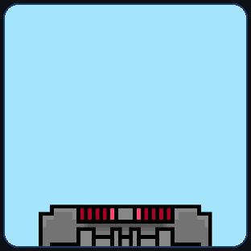
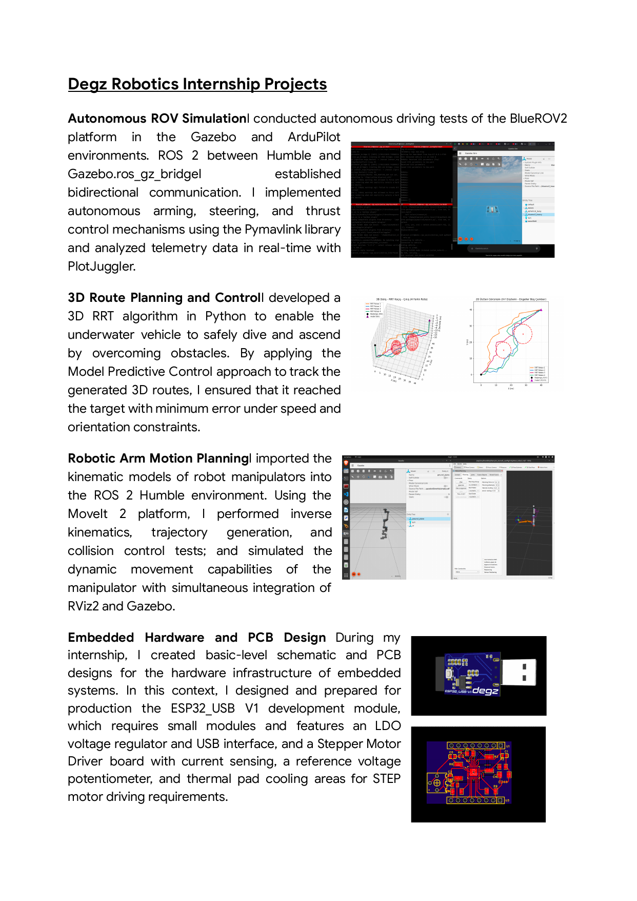

<h1 align="center">Muhammet Enes Aydın</h1>

<p align="center">
  <b>AI &amp; Autonomous Systems · Robotics · Computer Vision · Embedded &amp; Security</b>
</p>

<p align="center">
  <a href="https://www.linkedin.com/in/enesaydin0000">
    
  </a>
  <a href="mailto:enesaydin435@gmail.com">
    
  </a>
  <a href="https://leetcode.com/u/Enes_435/">
    
  </a>
  <a href="https://www.codewars.com/users/Enes_435">
    
  </a>
  <a href="./portfoy_Eng.pdf">
    
  </a>
  
</p>

## 🚀 About Me


- 🎓 Engineering student & developer focused on **AI & Autonomous Systems** across **Robotics**, **Computer Vision**, **Embedded / PCB**, **Protocol Security**, and **Full-Stack Web**.
- 🤖 Building real-time simulation-to-hardware stacks with **ROS 2 (Humble)**, **Gazebo**, **ArduPilot**, **MoveIt 2**, **PyTorch**, **OpenCV**, and **NVIDIA TensorRT**.
- 🏆 **Teknofest** competitor (**Air Defense**, **Combat UAV**, **USV**, **NLP**) — open to collaborations.

```python
# engineer_profile.py
class MuhammetEnesAydin:
    focus     = ["Robotics", "Computer Vision", "Embedded & Security"]
    autonomy  = ["ROS 2 Humble", "Gazebo", "ArduPilot", "MoveIt 2", "MPC"]
    ai_vision = ["PyTorch", "YOLOv7/v8", "TensorRT (150 FPS)", "OpenCV"]
    hardware  = ["ESP32", "LoRa", "PCB Design", "CAN / OCPP Protocols"]
    web_stack = ["FastAPI", "React.js", "PostgreSQL", "Gemini API"]
    mindset   = "Simulation -> Optimization -> Field Deployment"
```


<p align="center">
  
  &nbsp;&nbsp;
  
</p>


## 🛠️ Tech Stack & Core Domains

<p align="center">
  
</p>

<div align="center">

| Domain | Technologies |
| :--- | :--- |
| **🤖 Robotics & Autonomy** | ROS 2 (Humble), Gazebo, ArduPilot, PX4, MAVLink / Pymavlink, MoveIt 2, RViz2, PlotJuggler, 3D RRT / RRT\* / MPC |
| **🧠 AI & Computer Vision** | PyTorch, OpenCV, NVIDIA TensorRT (FP16/INT8), YOLOv7/v8, DeepSORT / ByteTrack, MediaPipe, TabPFN, Scikit-learn, Jupyter |
| **🔌 Embedded & Hardware** | ESP32, Arduino, LoRa, Schematic & PCB Design, CAN Bus, Stepper Drivers, Linux / Ubuntu, Docker, Make |
| **🛡️ Security & Full-Stack Web** | CAN–OCPP Anomaly Detection, FastAPI, Flask, React.js, Gemini API, PostgreSQL, C2 Interfaces |

</div>

---

## 📄 Portfolio

<p align="center">
  <a href="./portfoy_Eng.pdf">
    
  </a>
</p>

<p align="center">
  <a href="./portfoy_Eng.pdf">
    
  </a>
</p>

<details>
<summary><b>📖 View Remaining Portfolio Pages (Pages 2–5)</b></summary>
<br/>
<p align="center">
  <a href="./portfoy_Eng.pdf"></a><br/><br/>
  <a href="./portfoy_Eng.pdf"></a><br/><br/>
  <a href="./portfoy_Eng.pdf"></a><br/><br/>
  <a href="./portfoy_Eng.pdf"></a>
</p>
</details>
